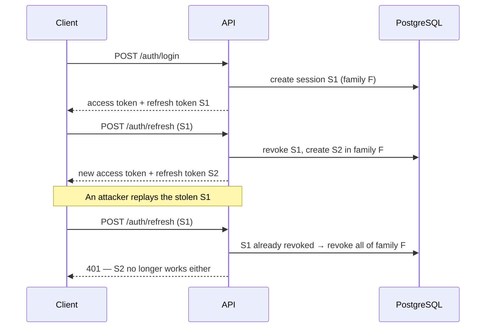

# NestJS Auth Starter

[](https://github.com/cemxbt/nestjs-auth-starter/actions/workflows/ci.yml)


Authentication and authorisation foundation for NestJS APIs: short-lived JWT access
tokens, rotating refresh sessions with reuse detection, and role-based access control,
backed by PostgreSQL through Prisma.

## Features

- **Register / login** with Argon2id password hashing and normalised emails
- **Short-lived access tokens** (JWT, 15 minutes by default)
- **Refresh token rotation** — every refresh issues a new token and revokes the old one
- **Reuse detection** — replaying a rotated token revokes the entire session family
- **Session management** — list active sessions, log out one device or all of them
- **RBAC** — `@Roles()` decorator with global guards; routes are private unless marked `@Public()`
- **Hardening** — rate-limited auth endpoints, Helmet headers, strict DTO validation,
  timing-safe comparisons and no user enumeration on login
- **Validated configuration** — the app refuses to start with missing or weak settings
- **OpenAPI docs** at `/docs`, health check at `/health`
- **Tested** — unit tests plus end-to-end tests against a real PostgreSQL database, run in CI

## Quick start

```bash
git clone https://github.com/cemxbt/nestjs-auth-starter.git
cd nestjs-auth-starter
cp .env.example .env            # then set JWT_ACCESS_SECRET
docker compose up -d            # PostgreSQL 16
npm install                     # also generates the Prisma client
npx prisma migrate deploy
npm run db:seed                 # optional: creates an admin user
npm run start:dev
```

Open http://localhost:3000/docs to explore the API.

## API

| Method | Path | Access | Description |
|---|---|---|---|
| `POST` | `/auth/register` | Public | Create an account and start a session |
| `POST` | `/auth/login` | Public | Exchange credentials for a token pair |
| `POST` | `/auth/refresh` | Public | Rotate a refresh token |
| `POST` | `/auth/logout` | User | Revoke the current session |
| `POST` | `/auth/logout-all` | User | Revoke every session of the user |
| `GET` | `/auth/sessions` | User | List active sessions |
| `GET` | `/users/me` | User | Current user profile |
| `GET` | `/users` | Admin | List users |
| `PATCH` | `/users/:id/role` | Admin | Change a role and revoke that user's sessions |
| `GET` | `/health` | Public | Database-backed health check |

## How refresh sessions work



A refresh token looks like `<sessionId>.<secret>`. Only a SHA-256 hash of the secret is
stored, so a leaked database does not contain usable tokens. Because the secret is 256 bits
of randomness, a fast hash is appropriate here; passwords, which are low-entropy, use Argon2id.

The old session is claimed with a conditional `UPDATE ... WHERE revokedAt IS NULL` inside a
transaction. If two requests race with the same token, only one can win; the other is treated
as reuse.

## Design decisions and trade-offs

- **Stateless access, stateful refresh.** Access tokens are verified without a database call,
  which keeps every request cheap. The cost is that logout or a role change takes effect for
  the access token only when it expires, so it is kept short. Refresh sessions are stored,
  which is what makes revocation and reuse detection possible.
- **Role changes revoke sessions.** Roles are embedded in the access token, so changing a role
  revokes the user's refresh sessions to force a fresh login with the new role.
- **Tokens in the response body.** This suits mobile and server clients. A browser-only
  frontend would usually move the refresh token into an `HttpOnly`, `SameSite` cookie.
- **Deny by default.** The JWT guard is global; forgetting to protect a route is not possible,
  forgetting to make one public only produces a `401`.

## Project structure

```
src/
├── auth/
│   ├── decorators/        @Public, @Roles, @CurrentUser
│   ├── dto/               request validation
│   ├── guards/            JWT authentication and role authorisation
│   ├── auth.service.ts    register, login, refresh, logout
│   └── sessions.service.ts  refresh rotation and reuse detection
├── users/                 profile and admin endpoints
├── prisma/                Prisma client with the PostgreSQL driver adapter
├── config/                environment validation
└── main.ts
prisma/
├── schema.prisma
├── migrations/
└── seed.ts
test/                      end-to-end tests
```

## Testing

```bash
npm test            # unit tests
npm run test:e2e    # end-to-end tests (needs the database from docker compose)
```

## Configuration

| Variable | Default | Description |
|---|---|---|
| `DATABASE_URL` | — | PostgreSQL connection string |
| `JWT_ACCESS_SECRET` | — | Signing secret, at least 32 characters |
| `JWT_ACCESS_TTL` | `15m` | Access token lifetime |
| `REFRESH_TOKEN_TTL_DAYS` | `30` | Refresh session lifetime |
| `PORT` | `3000` | HTTP port |
| `SEED_ADMIN_EMAIL` / `SEED_ADMIN_PASSWORD` | — | Credentials used by `npm run db:seed` |

## License

[MIT](LICENSE)
